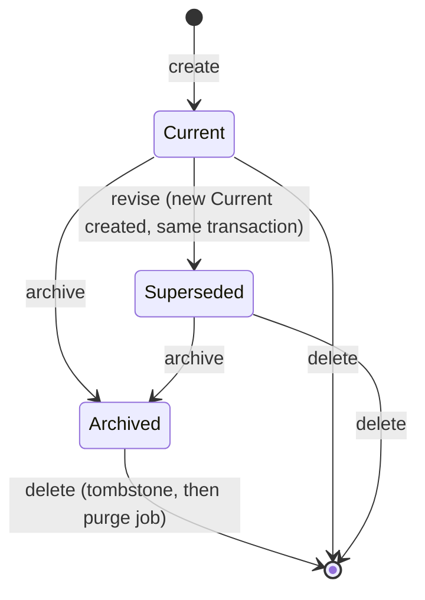

# Agent change plan: apply owner decisions to the SACW workspace

**Audience:** coding/documentation agent working in `900M100CK/scrum-workspace-KMS-ai`.
**Owner:** Chinhkhang (single developer). **Date prepared:** 13 October 2026.
**Inputs (attach or copy into `docs/decisions/` first):**
- `owner-decisions-OD-02-03-04-11.md` (ADR-0007 to ADR-0011, PRD v0.5 and SAD v0.6 patch lists, post-apply checks)
- `research-question-and-advisor-note.md` (BRD §13.4 text, Part B only)

**Goal:** bring PRD, SAD, ADRs, contracts, scope data, evaluation set and the register in line with the owner decisions, with every check run and reported honestly. No runtime code is written in this plan.

---

## 0. Rules for the agent

1. **No approval claims.** These are author-prepared decisions that become Accepted when the owner commits. Never write "approved", "reviewed" or "verified at runtime". Record them as "author-prepared, owner-committed".
2. **Do not edit BRD sections 1 to 12.** BRD §13.4 is added as a **proposed addendum** (mark `Status: Proposed addendum, pending owner and advisor confirmation`). Do not bump the BRD baseline version.
3. **IDs are never reused.** FR-45 stays as a `Withdrawn` row. Do not renumber FRs, ACs, BRs, SCs or ADRs.
4. **One task per commit.** Commit message: `docs(<area>): <task id> <summary>`. Do not mix tasks.
5. **Paths below are assumptions** unless stated. Run T0 first and correct paths from what actually exists. If a required file is missing, stop and report it.
6. **Stop and ask the owner** (do not guess) when: counts in any validator disagree with this plan after T6; a contract test depends on `Draft` or FR-45; the submodule cannot be reconciled without pushing upstream; any decision here conflicts with text you find in the repo.
7. Agent-facing documentation is written in English.

---

## Task overview

| ID | Task | Depends on | Output |
| --- | --- | --- | --- |
| T0 | Inventory and baseline check | none | `docs/planning/change-inventory.md` |
| T1 | Reproducible environment | T0 | `.nvmrc`, CI note, check results |
| T2 | Create ADR-0007 to ADR-0011 | T0 | `docs/adr/*.md` |
| T3 | Apply PRD v0.5 patch | T2 | `docs/sdlc/PRD_SRS.md` |
| T4 | Apply SAD v0.6 patch | T2, T3 | `docs/architecture.md` |
| T5 | Contracts and data model notes | T3, T4 | `contracts/**`, `docs/data/**` |
| T6 | Scope data and validators | T3 | scope JSON, validator constants |
| T7 | Research question and evaluation labels | T2 | BRD §13.4, `eval/**` |
| T8 | Register and changelog | T2 to T7 | `docs/sdlc/artifact-register.md` |
| T9 | Verification and report | all | `docs/planning/change-report.md` |
| T10 | Test skeleton for T-1 to T-4 | T4, T9 | `tests/concurrency/**` (skeletons only) |

---

## T0. Inventory and baseline check

**Steps**
1. Confirm the working tree is clean: `git status --short` (must be empty). Record the HEAD hash.
2. Run the inventory commands and save the output summary to `docs/planning/change-inventory.md`:

```bash
git rev-parse HEAD
node --version && cat package.json | grep -A3 '"engines"'
git submodule status

# Draft / FR-45 / publish references
grep -rniE "draft (version|state)|\bDraft\b|FR-45|publisher|publish" \
  docs specs contracts eval tests --include='*' -l

# Counts that validators may hard-code
grep -rnE "\b69\b|\b68\b|\b61\b" docs/planning contracts eval scripts 2>/dev/null | head -50

# Locate files this plan names
ls docs/sdlc docs/planning docs/adr contracts specs eval 2>&1
```

3. Run the existing checks **before changing anything** and record pass/fail and the Node version used:

```bash
npm run context:lint
npm run context:check
npm run context:test
```

**Done when:** inventory lists every file mentioning Draft, FR-45, counts 69/68/61, and states which task owns each file. Baseline check results are recorded.

---

## T1. Reproducible environment

**Context:** earlier checks ran on Node 22.23.0 while the repository requires Node 24 or later. The shared template submodule has uncommitted team templates, so a clean clone may differ from the local tree.

**Steps**
1. Add `.nvmrc` containing the required major version from `package.json` `engines` (expected: `24`). Do **not** change `engines`.
2. Re-run the three checks under that Node version. If Node 24 cannot be installed, stop and report; do not lower `engines`.
3. Submodule: run `git submodule status` and `git -C <submodule> status --short`. **Do not push upstream and do not vendor files.** Record in the inventory: pointer hash, whether it exists upstream, and the list of uncommitted paths. The owner decides between "commit upstream" and "vendor into the repo".
4. Clean-clone test:

```bash
tmp=$(mktemp -d) && git clone --recurse-submodules "$(git remote get-url origin)" "$tmp/repo" \
  && cd "$tmp/repo" && npm ci && npm run context:check
```

**Done when:** results from the working tree and from the clean clone are both recorded, including failures.

---

## T2. Create ADR-0007 to ADR-0011

**Steps**
1. Split `owner-decisions-OD-02-03-04-11.md` into five files following the existing ADR naming and template in `docs/adr/`:
   `ADR-0007-document-access-model.md`, `ADR-0008-fixed-sprint-lifecycle.md`, `ADR-0009-versions-and-lifecycle-no-draft.md`, `ADR-0010-five-month-scope-and-capacity-gate.md`, `ADR-0011-document-creation-order-and-guard-exempt-reads.md`.
2. Keep each ADR's content verbatim. Add the repo's standard front matter. Set `Status: Accepted (effective on owner commit)`.
3. Add amendment notes (do not rewrite the original decision text):
   - ADR-0002: `Amended by ADR-0011 (document creation order, guard-exempt internal reads).`
   - ADR-0006: `Clarified by ADR-0011 Decision B (guard scope).`
   - ADR-0001: `Related: ADR-0007.`
4. Update the ADR index/README table.

**Done when:** five new ADR files exist, three amendment notes are present, the index lists all, and the lint passes.

---

## T3. Apply PRD v0.5 patch

Follow Section 6 of `owner-decisions-OD-02-03-04-11.md` exactly. Checklist:

- [ ] Header: version `0.5`; add `applies ADR-0007 to ADR-0010`.
- [ ] §1 Core paragraph and §2 classification paragraph: remove Draft text as specified.
- [ ] FR-11 / AC-11 replaced with the given row.
- [ ] FR-45 row set to `Withdrawn by ADR-0009 (13 October 2026). ID retained for continuity; not reused.`
- [ ] FR-45 removed from SC-05, BR-05 traceability, and the D1 list.
- [ ] FR-12/AC-12, FR-19/AC-19, FR-47/AC-47 reworded without Draft.
- [ ] §5 second paragraph and §7 second paragraph replaced as specified.
- [ ] §9 ASM-02/ASM-03 marked `Accepted (ADR-0007, ADR-0008)`.
- [ ] §11: OD-02, OD-03 closed; OD-04 closed except physical retention; OD-11 closed by ADR-0010 with the Week-2 gate.
- [ ] Counts: active FRs 68 (54 P0, 13 P1, 1 P2); overlay 60 Must / 3 Should / 4 Could / 1 Won't. **Recompute these from the file before writing them**, using:

```bash
# Example: count active FR rows by priority (adjust the pattern to the table format)
grep -E '^\| FR-[0-9]+ ' docs/sdlc/PRD_SRS.md | grep -v Withdrawn | wc -l
grep -E '^\| FR-[0-9]+ \| P0' docs/sdlc/PRD_SRS.md | grep -v Withdrawn | wc -l
```

If recomputed counts differ from 54/13/1 or 60/3/4/1, **stop and report**; do not force the numbers.

**Done when:** the checklist is complete and `grep -n "Draft" docs/sdlc/PRD_SRS.md` returns only intentional historical/Withdrawn references.

---

## T4. Apply SAD v0.6 patch

Follow Section 7 of the decisions file. Checklist:

- [ ] §1.3: rows for ADR-0007 to ADR-0011; ADR-0002 marked amended.
- [ ] §2.3 contract invariant 4: validity values `current | superseded | archived`.
- [ ] §3.1: add the guard-exempt sentence for `/internal/policy/*` and `/internal/state/*`.
- [ ] §3.2 Flow 2 replaced with the two-step creation and the lifecycle state machine.
- [ ] §3.2 Flow 3 step 3: all `Draft` mentions removed.
- [ ] §7.1 traceability: FR-45 removed from BR-05 and SC-05; ADR-0011 added to BR-10 and BR-14.

Add this state machine to Flow 2 as a Mermaid block (also store it as the single diagram source, see T8):



**Done when:** the checklist is complete and no SAD flow mentions Draft or an activation step for document creation.

---

## T5. Contracts and data model notes

**Steps**
1. OpenAPI/JSON schema: remove `draft` from the `validity` enum; remove the publish operation if one exists; keep operation IDs stable and note the removal in the contract changelog.
2. Not-found shape (ADR-0007): confirm unauthorised and nonexistent document reads return the same status, body and schema. Add a schema test fixture if missing.
3. Add a `contracts/CHANGELOG.md` entry:
   `0.x: removed validity=draft; removed publish operation (ADR-0009). Breaking for any client using them.`
4. Data model doc (DATA-04): add `blocker_events` (append-only) and note that `is_blocked` is derived, using the SQL in ADR-0008. Add `document_acls.acl_version`.
5. Do **not** write migrations or application code.

**Done when:** `grep -rn "draft" contracts` has no enum or operation matches, and contract validation passes.

---

## T6. Scope data and validators

**Steps**
1. Update the release-scope data file found in T0 (expected `docs/planning/release-scope.json`) so FR-45 is `withdrawn` and counts become 60 / 3 / 4 / 1 (Must / Should / Could / Won't).
2. Update the validator constants. Replace hard-coded totals with values **derived from the data file**, so this change is not repeated next time:

```ts
// Before (example)
const EXPECTED = { fr: 69, must: 61, should: 3, could: 4, wont: 1 };

// After (example): derive, then assert only invariants
const active = frs.filter(f => f.status !== 'withdrawn');
const byPriority = (p: string) => active.filter(f => f.release === p).length;
assert(byPriority('must') + byPriority('should') + byPriority('could') + byPriority('wont') === active.length);
```

3. Re-home FR-45's acceptance into the FR-11 spec (the spec file that owned FR-45 now lists FR-45 as withdrawn and moves its test cases to FR-11 where still relevant).
4. Run `npm run context:lint && npm run context:check && npm run context:test`.

**Done when:** all three pass with no hard-coded 69/61, or failures are documented with their cause.

---

## T7. Research question and evaluation labels

**Steps**
1. Add BRD §13.4 from Part B of `research-question-and-advisor-note.md` as a **proposed addendum**. Do not change the BRD version.
2. Create `eval/config/configurations.yaml` with C0, C1, C2 as specified. Leave provider and model version as `"<frozen provider id>"` placeholders (OD-06 is open).
3. Add a `group` label (`doc | state | both`) to each existing evaluation question file. Where the correct label is not obvious, set `group: unlabeled` and list those question IDs in the report. **Do not guess.**
4. Print the distribution:

```bash
grep -rhE '^group:' eval/questions | sort | uniq -c
```

5. Report which group is under-represented relative to a roughly even split. Do not invent new questions in this task.
6. Add a note to the evaluation plan: rubrics, reference answers and thresholds are committed **before** any run (OD-07).

**Done when:** BRD §13.4 exists as an addendum, the config file exists, every question has a label or an explicit `unlabeled` entry, and the distribution is reported.

---

## T8. Register and changelog

**Steps**
1. `artifact-register.md` v0.16: add rows for ADR-0007 to ADR-0011 (status Accepted on owner commit); update PRD to v0.5 and SAD to v0.6; update the BRD row to note the proposed §13.4 addendum.
2. Move the "Historical" sections of the register into `CHANGELOG.md` (or `docs/sdlc/CHANGELOG.md`), leaving the register with current rows only. If this makes the diff too large to review, do the move in a separate commit.
3. Diagrams: for each diagram that exists as both `.mmd` and `.drawio`, list them in the inventory. **Do not delete either format**; propose the single-source choice to the owner in the report.
4. Add the sentence: `Author-prepared decisions committed by the owner; no runtime tests have been run; no independent approval.`

**Done when:** the register reflects all new versions and the changelog holds the history.

---

## T9. Verification and report

Run the full verification and write `docs/planning/change-report.md` with these sections:

1. HEAD before and after; list of commits (hash, task ID, summary).
2. Check results table:

| Check | Before (T0) | After | Node version |
| --- | --- | --- | --- |
| `context:lint` | | | |
| `context:check` | | | |
| `context:test` | | | |
| clean-clone `context:check` | | | |

3. Residual references:

```bash
grep -rniE "draft (version|state)|FR-45|publisher" docs specs contracts eval tests
```

   Every remaining hit must be classified: `historical`, `withdrawn row`, or `needs owner decision`.
4. Open items for the owner: submodule decision, diagram single-source decision, unlabeled evaluation questions, provider selection (OD-06), physical retention (ADR-0009, not decided).
5. Explicit statement of what was **not** done: no runtime code, no migrations, no tests executed against a running system.

---

## T10. Test skeleton for guard behaviour (skeletons only)

Create failing-by-design placeholders (marked `todo`) for the four ADR-0011 tests so SP-01 starts from them. No implementation.

```ts
// tests/concurrency/guard.spec.ts
import { describe, it } from 'vitest';

describe('ADR-0011 guard and creation order', () => {
  it.todo('T-1: with the guard held by a handoff, 10 concurrent internal policy reads finish within policy_timeout_ms');
  it.todo('T-2: a revocation attempted during a held handoff blocks until release or abort, then commits');
  it.todo('T-3: crash between Workspace ACL commit and Knowledge persist; retry with the same key creates exactly one version');
  it.todo('T-4: an ACL row without content returns the same response as an unknown document id');
});
```

**Done when:** the file exists, the test runner lists four `todo` tests, and lint passes.

---

## Order of work

`T0 -> T1 -> T2 -> (T3 -> T4 -> T5, T6) -> T7 -> T8 -> T9 -> T10`

T7 can run in parallel with T3 to T6 if it only touches BRD §13.4 and `eval/`.

## Out of scope

- Application code, migrations, provider integration.
- Choosing the AI provider or the physical retention policy.
- Editing BRD sections 1 to 12.
- Removing the FR-45 row, either diagram format, or either side of the submodule decision.

## Final handoff message (agent output template)

```
Applied: T0..T10 (list any skipped with reason)
Checks: see docs/planning/change-report.md
Stopped for owner: <list or "none">
Counts after change: FR active=<n> P0=<n> P1=<n> P2=<n>; overlay Must/Should/Could/Won't=<n>/<n>/<n>/<n>
Not done: runtime code, migrations, runtime tests
```
